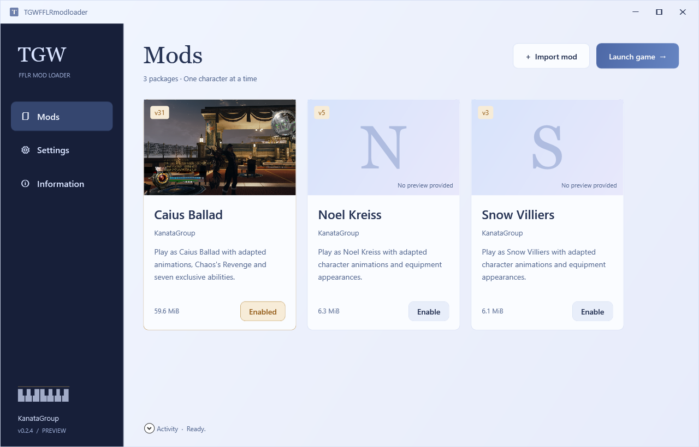

# TGWFFLRmodloader

A character-mod manager and session launcher for **LIGHTNING RETURNS: FINAL FANTASY XIII — Windows Steam edition**, by **KanataGroup**.

Import compatible character packages, choose a character, and launch a modded session from one interface. The tool restores the original game files after the session ends.

## Part of KanataGroup's broader plans

TGWFFLRmodloader is one of the projects in KanataGroup's broader development plans. The **TGWmod development software** may be made publicly available once it reaches a mature stage. A public release and timeline have not yet been confirmed.

**Windows x64 · .NET 10 Desktop Runtime · English / Japanese interface · Closed source · Preview**

[**Download v0.2.4 for Windows x64**](https://github.com/SawamiKanata/TGWFFLRmodloader/releases/tag/v0.2.4) · [User guide](USER_GUIDE.md) · [Use cases](USE_CASES.md) · [Troubleshooting](TROUBLESHOOTING.md)

## What you can do

- Keep compatible character mods together in a visual library.
- Import native `.TGW` packages and supported legacy patch archives.
- Select one character package for your next game session.
- Follow preparation, launch, exit, and restoration progress.
- Right-click a card to set artwork, export a `.TGW` package, or delete its imported copy to the Recycle Bin.
- Switch the interface between English and Japanese.

## When to use it

| Your goal | How the tool helps |
| --- | --- |
| Play as a different character | Import a compatible package, enable its card, and launch from the tool. |
| Keep several character mods available | Store them as separate cards and choose one before each session. |
| Record a character-mod showcase | Choose the package before recording, then wait for restoration after leaving the game. |
| Return to the original game | Finish the modded session and allow restoration to complete before launching directly through Steam. |
| Organize or share your own compatible package | Add a preview image, export `.TGW`, or remove an imported copy without deleting the original download. |

Read the [use-case walkthroughs](USE_CASES.md) for the full workflow and its limits.

## Requirements

- A Windows x64 PC and a Steam installation of **LIGHTNING RETURNS: FINAL FANTASY XIII**.
- The **[.NET 10 Desktop Runtime for Windows x64](https://dotnet.microsoft.com/en-us/download/dotnet/10.0)**. Select **.NET Desktop Runtime → Windows → x64**. You do not need the SDK.
- Original game files matching the requirements of the character package.
- A compatible mod package, obtained separately. Character packages are **not bundled** with the launcher.
- Write access to the game folder and enough free space for temporary patch files.

## Quick start

1. Open [the v0.2.4 release](https://github.com/SawamiKanata/TGWFFLRmodloader/releases/tag/v0.2.4) and download **`TGWFFLRmodloader-v0.2.4-win-x64.zip`** from **Assets**.
2. Extract the entire ZIP to a writable folder. Install the required Desktop Runtime if needed.
3. Start Steam, close the game, and run **`TGWFFLRmodloader.exe`**.
4. When prompted, select the game folder containing **`LRFF13.exe`**.
5. Choose **Import mod** and select a compatible `.TGW` package. Import it directly; do not extract or rename it.
6. Choose **Enable** on the card you want to use. Selection is saved; it does not patch the game immediately.
7. Choose **Launch game**. Keep the tool open or minimized while playing.
8. Exit the game and wait until restoration finishes and the tool reports **Ready**. You can then close the tool or start the original game through Steam.

For installation, switching characters, deletion, exporting, updates, and recovery, see the [complete user guide](USER_GUIDE.md).

## How a session works

**Choose a package → Verify original files → Apply temporary patches → Play → Detect game exit → Restore originals → Ready**

This preview temporarily patches files **on disk**, including the game executable and archives as required by a package. It keeps compact recovery data and restores originals after the game exits. It is not an in-memory loader, and there is a restoration period after gameplay.

Keep the tool open during a session. Do not update, verify, manually mod, or relaunch the game while patching or restoration is active. If the tool or PC stops unexpectedly, reopen the tool and use **Settings → Restore original** after closing the game. Keep the recovery data until the process completes.

## Supported scope

- Native `.TGW` packages and supported legacy data/patch ZIP packages.
- Compatible Caius v30/v31, Noel v5, and Snow v3 package formats are supported by the importer.
- **One character package per session.** Change your selection between sessions.
- Save files are not modified or backed up by the launcher.

General mod stacking, conflict merging, live character switching, and arbitrary third-party mod formats are not implemented. A package still needs to match your game files. See [Troubleshooting](TROUBLESHOOTING.md) for compatibility and recovery issues.

## Preview status

Version **0.2.4** is an early preview. The patch/recovery engine has passed isolated synthetic-file tests, and import/export and interface workflows have been checked. End-to-end gameplay and Steam handoff with this launcher have not yet been fully validated. Please report reproducible results through [Issues](https://github.com/SawamiKanata/TGWFFLRmodloader/issues).

## Downloads and source availability

This repository is the public home for **documentation, issue reports, and compiled releases**. The application source code is kept private and is not included in this repository or its downloadable release package.

Download the **`-win-x64.zip`** asset. GitHub also displays automatically generated **Source code** archives; for this documentation-only repository, those contain the public documentation rather than the application source. [GitHub explains these generated archives here](https://docs.github.com/en/repositories/releasing-projects-on-github/about-releases).

Official compiled releases may be downloaded and used free of charge under the accompanying [proprietary notice](LICENSE.txt).

## Credits and feedback

Developed by **KanataGroup** · [SawamiKanata](https://github.com/SawamiKanata)

Report bugs or request features in [Issues](https://github.com/SawamiKanata/TGWFFLRmodloader/issues). Include the launcher version, interface language, mod/package version, the steps you followed, and the exact error text. Review screenshots and logs before posting them publicly.

This is an unofficial fan-made tool. Game names, characters, trademarks, and third-party assets belong to their respective owners. See [Third-party notices](THIRD_PARTY_NOTICES.md).
